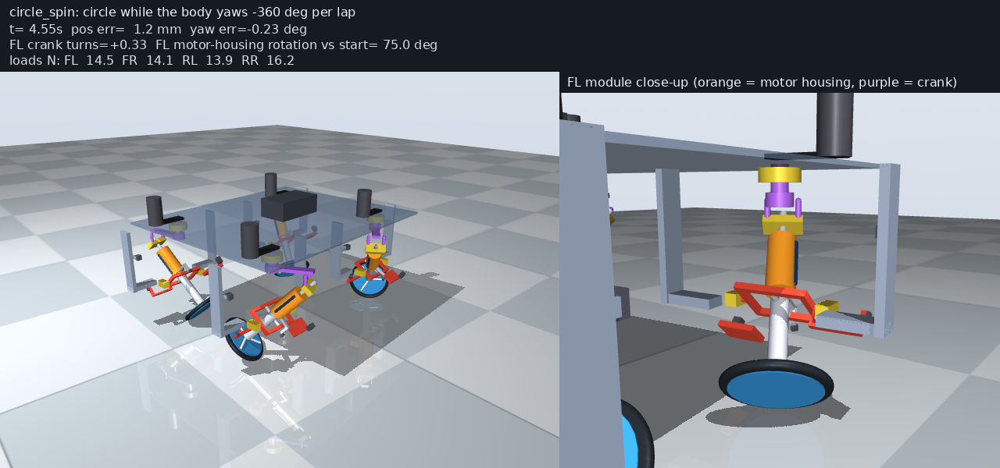
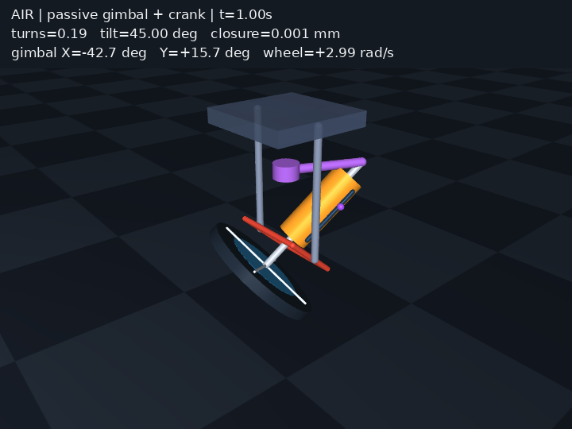
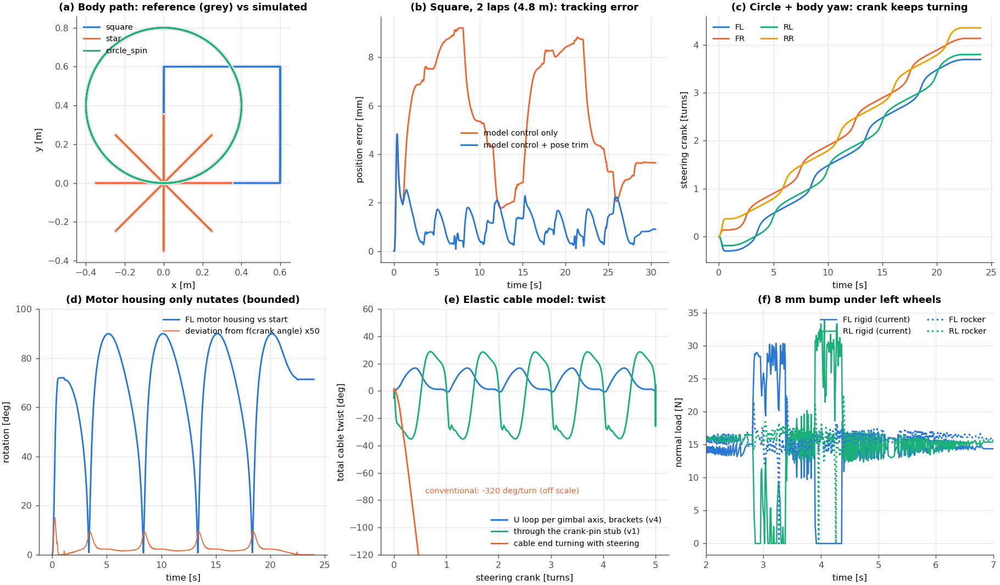
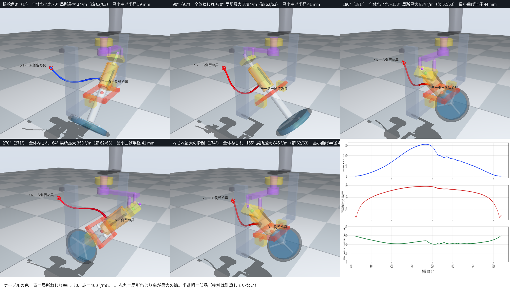

# Nutating Swerve

**An eccentric-crank, gimbal-mounted steering module for omnidirectional robots: endless steering without slip rings. The drive motor nutates but never spins.**

[日本語版 README](README.ja.md)



*Left: the four-module vehicle driving a 0.4 m circle while the body yaws one turn per lap. Right: one module. Orange = motor housing (nutates, does not spin), purple = steering crank, red = passive gimbal ring, blue = wheel. Everything here is a MuJoCo model; no hardware has been built yet.*

## The idea in one paragraph

A swerve module steers a driven wheel about a vertical axis. If the drive motor rides on the steered part, its cable must cross a joint that turns without limit, which normally means a slip ring, a bevel-gear coaxial drive, or a steering range limit. This module avoids all three. The motor housing is held at a pivot **P** by a passive two-axis gimbal, and a crank orbits the rear end of the housing on a horizontal circle. The housing axis then sweeps a 45° cone around the vertical: it *nutates*. Because the gimbal forbids rotation about the housing's own axis, the housing returns to exactly the same attitude after every crank turn. Its cable therefore sees a bounded, periodic motion and never winds up, while the wheel's heading goes around endlessly.

Terminology: "nutating" is used in the mechanical-engineering sense (a nutating plate wobbles on a skewed bearing but does not rotate, unlike a swash plate). "Swerve" is used because the module is a centred steerable wheel whose instantaneous planar velocity has rank 1, i.e. the vehicle is omnidirectional but not holonomic. It is not an offset "active caster".

## What is in this repository

| Folder | Content |
| --- | --- |
| [`single_wheel/`](single_wheel/) | One module in MuJoCo: closed-loop crank + gimbal, torque driven, 10 steering turns. Geometry checks, Jacobian rank, contact test. Japanese report in [`single_wheel/REPORT.md`](single_wheel/REPORT.md). |
| [`vehicle/`](vehicle/) | Four modules on a rigid chassis. Closed-form kinematics, model-based controller, 31 automated checks (tracking, wheel loads, bump, part clearance, elastic cable). Japanese report, bill of materials with candidate part numbers: [`vehicle/REPORT.md`](vehicle/REPORT.md), [`vehicle/BOM.md`](vehicle/BOM.md). |
| [`vehicle/teleop.py`](vehicle/teleop.py) | Drive the simulated vehicle by hand with the keyboard or a gamepad. Body-frame velocity commands are integrated into a reference pose that the same controller tracks. |
| [`vehicle/results/cable_simplify/`](vehicle/results/cable_simplify/) | The wiring study: how simple can the motor cable be? Eleven routing families compared with an elastic cable model, including the ones that fail and why. |

All documents inside the folders are in Japanese. This README and [README.ja.md](README.ja.md) summarise them.

## Mechanism



- **Spherical four-bar.** The crank axis (vertical), the housing axis (45° from vertical), and the two gimbal axes all pass through the pivot P. The crank pin sits at distance L = 120 mm from P along the housing axis, so it moves on a circle of radius L sin 45° at height L cos 45° (84.85 mm each).
- **Crank pin joint.** A spherical plain bearing (igubal EFOM-10 class) on the crank with a round stub from the housing passing through it. The stub can turn and slide in the bearing, so the loop is not over-constrained by manufacturing errors.
- **Passive gimbal.** Outer ring on two pillow blocks (x axis), housing on two trunnions in the ring (y axis). All four bearings are plain bushings (iglidur GFM-0810). Each gimbal angle swings ±45° and returns every turn.
- **Wheel.** 110 mm centre-line diameter, 10 mm urethane O-ring tread, on the housing axis 100 mm below P, driven directly by a 37 mm gear motor on the housing. The wheel plane is tilted 45°; the contact point is offset 31.8 mm from the steering axis.
- **Steering.** A second gear motor on the chassis drives the crank through a GT2 belt.

Contact-point velocity, chassis-fixed, with φ the crank angle and ψ the wheel angle relative to the housing:

```
v = ( J_phi(φ)·φ' + J_psi·ψ' ) · t ,      t = (−sin φ, cos φ)
J_psi = r_eff = 58.5 mm
J_phi(φ) = sinθ (sinθ·ρ − cosθ·h_P) + r_eff·σ(φ)
σ(φ) = −sin²θ cosθ cos²φ / (cos²θ + sin²θ sin²φ)        (Cardan-induced housing spin)
```

The radial component is identically zero, which is the rank-1 statement. The closed form agrees with the MuJoCo point Jacobian to 1e-16 m.

Because the housing cannot spin, the drive reaction torque is carried by the crank: `τ_steer = (J_phi/J_psi)·τ_drive`, between −1.25 and −1.96 for these dimensions. The steering motor must be sized for about twice the drive torque, and the controller feeds this coupling forward.

## What has been verified (MuJoCo 3.3.7, torque-driven, no kinematic cheats)

Single module:

| Check | Result |
| --- | --- |
| 10 steering turns with the wheel spinning, loop residual | 0.007 mm max |
| Housing attitude after each turn | returns to within 2e-6° |
| Gimbal angles | bounded, ±45° |
| Planar velocity Jacobian at tilts 30°, 45°, 60° | rank 1 (singular value ratio ≤ 4e-16) |

Four-module vehicle (all 31 checks in [`vehicle/results/verification.json`](vehicle/results/verification.json) pass):

| Scenario | Max position error | RMS | Max yaw error | Crank turns |
| --- | ---: | ---: | ---: | --- |
| 0.6 m square, 2 laps, heading fixed, 0.43 m/s | 4.8 mm | 1.3 mm | 0.8° | 1.5–2.0 |
| 0.4 m circle, 3 laps, heading fixed | 4.8 mm | 1.3 mm | 0.25° | 2.8–3.3 |
| 0.4 m circle, 2 laps, body yaws −360°/lap | 4.2 mm | 1.1 mm | 0.37° | 3.7–4.4 |
| 8-direction star, 0.35 m out and back | 4.8 mm | 1.0 mm | 0.47° | 0.6–1.1 |
| Spin in place, one turn | 1.6 mm | 0.8 mm | 0.42° | ±0.1 |
| 8 mm bump under the left wheels (rigid chassis) | 6.7 mm | | 1.3° | one wheel lifts briefly |

The housing attitude stayed within 0.37° of the pure function of crank angle in every test, which is the physical guarantee that the cable motion is periodic. Peak torques were 0.5 N·m steering and 0.29 N·m drive. Parts stay ≥ 3 mm apart over a full steering turn (570 pairs checked). Module mass 0.92 kg, vehicle 6.1 kg, footprint 0.70 × 0.60 m, plate at 0.27 m.



## The wiring question

The periodic housing motion makes slip-ring-free wiring possible, but not automatically simple. The study in [`vehicle/results/cable_simplify/`](vehicle/results/cable_simplify/) compares routes with an elastic cable model (5 mm PUR cable, straight stress-free shape, 5 steering turns). Three facts determine everything:

1. **Side exits flip.** The housing does not spin while its tilt direction goes around, so a point on the motor's "upper, inboard" face at 0° is on the "lower, outboard" face at 180°. A taut cable from such a point locks the mechanism after 0.08 turns.
2. **Off-axis fixed points need a lot of slack.** A clamp on the chassis away from the steering axis sees the cable length vary by about twice the orbit radius (≈ 200 mm for the stub end). That slack has nowhere safe to hang and lands on the crank or the frame.
3. **Only two directions on the housing are tame:** the housing axis itself (the stub end) and the gimbal trunnion axes. Along those, the relative motion to the next body is a single ±45° hinge or a pure cone.

Routes that work, and what each costs:

| Route | Free spans | Extra parts | Twist per turn | Max twist rate | Min bend radius | Clearance | Height |
| --- | --- | --- | ---: | ---: | ---: | ---: | ---: |
| **v4 (built into the BOM):** hook and bridge brackets carry the cable to each gimbal axis; a U-loop per axis turns the ±45° into bending | 2 | 2 brackets, 4 clamps | −7…+17° | 106 °/m | 22 mm | 4.1 mm | 0 |
| **Hanging cable from the trunnion-side face** of the motor to a clamp under the plate 260 mm away, 0.30 m long | 1 | 2 clamps | −13…+101°, returns to 0 each turn | 341 °/m | 40 mm | 20 mm | 0 |
| **Through a hollow crank shaft** (stub end → over the crank arm → up the axis), bend radius 45 mm | 1 | hollow stub, hollow shaft, 2 clamps | −33…+21° | 99 °/m | 35 mm | 12 mm | +85 mm |
| Conventional (cable turns with the steering) | 1 | slip ring needed | −320°/turn, accumulates | — | — | — | — |



*The hanging cable at five phases, coloured by local twist rate. The twist is smooth and uniform along the length (no kink), peaks near 180° where the motor has rotated 90° about the trunnion axis, and returns to zero every turn.*

Which route to choose is a duty-cycle question, not a feasibility one. The bracketed v4 route meets industrial continuous-flex cable ratings (±180 °/m). The hanging cable is 2× over that rating but has no brackets at all; with individual thin wires and laboratory duty it is the simplest wiring that works. Splitting the cable into thin conductors relaxes every number in the table, since allowable twist rate and bend radius scale with conductor diameter.

## Alternatives considered

The complexity of this module buys three things at once: endless steering, no slip ring, and a motor directly on the wheel. Dropping any one gives a more conventional machine.

| Drop | Configuration | Moving cable | Endless steering | Trade |
| --- | --- | --- | --- | --- |
| motor on the wheel | coaxial swerve with a bevel pair, both motors on the chassis | none | yes | bevel gears and a large bearing; vertical wheel, 1:1 coupling |
| no slip ring | conventional swerve + 4–6 ring slip ring | slip ring | yes | contact wear, signal noise |
| endless steering | conventional swerve with ±2.5 turns of range (hollow shaft or automotive clock-spring cable) and unwinding when idle | twist only | no | the recorded scenarios wind at most 4.1 turns; ±2.5 turns covers all of them without unwinding except continuous circling |

Compared with a coaxial bevel swerve, this module is cheaper to make (bushings, a crank, a direct-drive wheel, no gears) and has a worse wheel: the 45° tilt makes the contact point drill (3.6 rad/s at 0.3 m/s), offsets it 32 mm, and loads the steering motor with twice the drive torque. Choose this module when fabrication simplicity matters more than tyre wear and efficiency.

## Limitations and open items

- Instantaneous planar velocity is rank 1: the module must re-steer before changing direction (about 0.46 s for 90°). This is a swerve, not a holonomic active caster.
- The contact drills and scrubs because the wheel is tilted. Tyre wear has not been estimated.
- Bearing friction and play, gear backlash, motor electrical dynamics, cable contact and fatigue life are not modelled. Cable stiffness values are order-of-magnitude.
- The controller uses ground-truth pose from the simulator for its small corrective term.
- Floors: flat, plus one 8 mm bump. A rigid chassis lets one wheel lift on the bump; a front rocker (±6°) is modelled as an option.
- Nothing has been built. Part numbers in the BOM are candidates taken from distributor datasheets.

## Reproduce

Linux, Python 3.10–3.12, MuJoCo 3.3.7. GUI needs OpenGL; headless runs need none; videos need `ffmpeg` and EGL or `xvfb-run`.

```bash
python3 -m venv .venv && source .venv/bin/activate
pip install -r requirements.txt

# single module: watch it, then run the checks
cd single_wheel
python run.py --mode air --wheel-speed 3 --cycles 3 --viewer --out results/my_air
python verify.py && python plot_results.py

# vehicle: drive scenarios, run all 31 checks (~10 min on one core)
cd ../vehicle
python run_quad.py --scenario circle_spin --viewer
python verify_quad.py && python plot_quad.py

# drive it yourself: arrow keys / , . in the viewer window, or a gamepad
python teleop.py                      # keyboard
python teleop.py --joystick auto      # gamepad (pygame if installed, else /dev/input/js0)

# cable routes
python cable_test.py --layout hook --turns 5        # v4, as in the BOM
python cable_test.py --layout hang --turns 5        # hanging cable (see results/cable_simplify/README.md for parameters)
python cable_test.py --layout pin  --turns 5        # through the hollow crank shaft
```

Each run writes `summary.json`, `trace.csv` and the exact `model.xml` used. Per-step traces and generated models are git-ignored; the committed `summary.json` files and figures are the numbers quoted above.

## License

MIT, see [LICENSE](LICENSE). If you use the mechanism or the models, a citation of this repository is appreciated.
